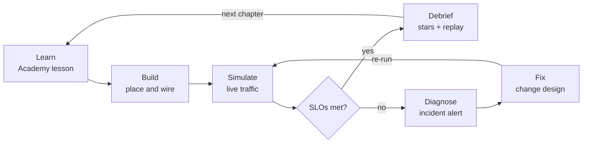
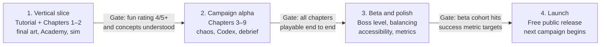

# Severity 1 — Product Requirements Document

November 18, 2026

## Overview

Severity 1 is a browser game that teaches system design by having players build real products, starting with a fictional social network, Friendbook, out of live infrastructure components, then watch real traffic stress and break them. Every concept is taught first through a short interactive lesson, then tested in a level where the player must use it to fix a failing system.

**The problem.** System design is usually learned from text, static diagrams and interview checklists. Learners memorize words like "cache" and "sharding" without ever seeing why a system needs them. Quiz-style tools test recall, not judgment.

**The vision.** Make a running system something you can see. Requests flow as particles, overloaded machines glow and smoke, queues pile up visibly, and users get angry when pages are slow. The player learns cause and effect by watching it happen, the way an engineer on call does.

**What the prototype proved.** The first prototype, a Build YouTube sandbox called Scale It, validated the core loop: build, send traffic, see what catches fire, fix, repeat. Playtesting surfaced two gaps this PRD addresses:

- **Not visual enough.** Boxes and lines read as a diagram, not a living system.
- **Concepts arrive before they are taught.** Players met load balancers and caches by failing first, with no foundation, and learned by guessing.

## Goals, non-goals and success metrics

Version 1 succeeds if players finish the Build Friendbook campaign able to explain and sketch its architecture, and say they had fun doing it.

**Goals**

1. **Make system behaviour visible.** Traffic, load, latency and failure are shown as animation, not numbers alone.
2. **Teach before testing.** Every concept gets a short interactive lesson before the player has to use it.
3. **Build real judgment.** Levels reward trade-offs (cost vs. reliability vs. speed), not a single memorized answer.
4. **Transfer to the real world.** Each level ends by showing how real companies solve the same problem.

**Non-goals for v1**

- Deploying real infrastructure or writing real code.
- Exact cloud vendor pricing or performance numbers. Numbers are simplified but directionally correct.
- Multiplayer, user-generated levels and an AI interview grader. These are candidates for later versions.
- A phone version. Desktop is primary and tablets are supported; the building canvas needs a large screen.

**Success metrics (proposed targets, to confirm after the first playtest)**

| Metric | Target |
| --- | --- |
| Players who finish the tutorial and Chapter 1 | 70% |
| Players who finish the full campaign | 35% (provisional; reset from vertical-slice completion data) |
| Score gain on a before/after "explain this architecture" check (FR-24) | +40 points out of 100 |
| Median session length | 20 minutes or more |
| Players returning within 7 days (measured by an anonymous local ID, FR-23) | 25% |
| Post-level "this was fun" rating | 4 out of 5 or higher |

## Target players

The primary player is a junior developer or student who can code but has never designed a system at scale. The game must also work for a curious non-engineer, so no coding knowledge is assumed.

| Persona | Who they are | What they need | What the game gives them |
| --- | --- | --- | --- |
| The Builder (primary) | CS student, bootcamp grad or junior developer | Understand how apps like social networks actually work behind the screen | A guided campaign that builds intuition from first principles |
| The Interview Prepper | Mid-level engineer preparing for system design interviews | Practice trade-offs and explaining designs under pressure | Harder levels, cost and SLO constraints, a reference architecture to compare against |
| The Curious Non-engineer | Product manager, founder or tech-adjacent learner | Speak the language of their engineering team | Plain-language lessons, analogies and a glossary they can revisit |

In v1 the Interview Prepper is served by harder SLOs, budget pressure and the reference-architecture comparison in each debrief; full interview mode is P2. The Curious Non-engineer is served by plain-language lessons and the Codex, which includes a searchable glossary (FR-26).

## Core game loop

Every chapter runs the same loop: learn a concept, build with it, run live traffic, and fix the design until it meets the level's service level objectives (SLOs).

The inner Simulate → Diagnose → Fix loop is where the fun lives. The Learn step in front of it is the main change from the prototype: players meet each concept in a lesson before it can cause their first outage.

## Concept introduction: the Academy

No component can be placed until the player has completed its Academy lesson. Each lesson takes under 3 minutes and follows the same four beats.

1. **Story hook.** A short, illustrated scene shows the problem in everyday terms. Example: a restaurant with one waiter and a line out the door, before the load balancer lesson.
2. **Analogy to architecture.** The scene morphs into the real component, mapping each part. The restaurant host becomes the load balancer and the waiters become app servers.
3. **Toy simulation.** A tiny sandbox with one or two controls. The player toggles the cache on and off and watches database load drop by 90%, or drags a slider to add servers and watches response time fall.
4. **Predict, then see.** One or two "what happens if…" questions answered by running the toy simulation, not by a quiz screen. Example: "If the cache dies, what happens to the database?"

After the lesson, the first real use of the component is a **guided build**: a ghost outline shows where it goes, and the player places and wires it. Later levels remove the scaffolding.

**Locking rule.** Every placeable component is unlocked by exactly one lesson in the curriculum below. A component with no lesson cannot be locked, so each row of the catalog must map to a row of the curriculum.

**Supporting features**

- **Codex.** Every completed lesson becomes a collectible concept card the player can reopen anytime, with its analogy, a short diagram and a "how real companies do it" note.
- **Test out.** Experienced players can skip a lesson by passing a short challenge level that uses the concept. A player who tests out of a chapter starts it from that chapter's reference starting design (see Content).
- **Just-in-time refreshers.** When an incident involves a concept, the incident panel links to its Codex card.

**Concept curriculum (v1)**

| Concept | Analogy used in the lesson | Toy simulation | Unlocks |
| --- | --- | --- | --- |
| Client–server and requests | Ordering at a counter | Send one request and follow it end to end | Users, App Server |
| Latency and throughput | A highway: speed vs. lanes | Add load and watch response time curve upward | Live metrics panel |
| Databases vs. object storage | Filing cabinet vs. warehouse | Try storing a photo in the database and watch it choke | Database, Object Storage |
| Horizontal scaling and load balancing | Restaurant host seating diners across waiters | Add servers with and without a host | Load Balancer, server scaling |
| Caching | Keeping popular books on the front desk | Toggle cache, change hit rate, watch DB load | Cache |
| Replication | Photocopies of a reference book | Add read replicas, then see writes still go to one place | Read Replicas |
| CDNs, DNS and geography | Local convenience stores vs. one central warehouse; DNS as the directory that points you to the nearest store | Viewers on a world map, with and without edge servers and nearest-region routing | CDN, DNS |
| Asynchronous processing | Dry cleaning ticket: drop off now, pick up later | Posting to 500 friends' feeds: blocking vs. queued | Message Queue, Worker |
| Search indexes | The index at the back of a book vs. reading every page | Search names by scanning the database, then by index; watch the index drift out of sync | Search Index |
| Sharding | Splitting a phone book A–M and N–Z | Pick a shard key and watch for hot shards | Sharded Database |
| Rate limiting | A bouncer at the door | Bot traffic with and without limits | Rate Limiter / API Gateway |
| Redundancy and failover | Spare tire | Kill a machine and see who survives | Multi-instance rules, Chaos events, Monitoring |

## Visual design and simulation presentation

The game is a website with polished, flat 2D design, built entirely from original art with no real-world brand names, logos or UI imitation: every component is an illustrated machine whose look changes with its load, and every request is a visible particle. A player should be able to tell what is wrong by looking, before reading any numbers.

**Components as machines**

| Component | Visual metaphor | How load shows |
| --- | --- | --- |
| App Server | Server rack with blinking lights | Lights speed up, rack glows orange, then red, then smokes and catches fire |
| Load Balancer | Traffic controller directing lanes | Arms move faster; lanes visibly unbalanced if misconfigured |
| Database | Vault with a clerk at the counter | Line of particles waiting at the counter grows; lock icons on contention |
| Cache | Shelf of glowing memory chips next to the server | Hits flash green and bounce back fast; misses fall through to the database |
| Object Storage | Warehouse of labeled crates | Loading dock congests when egress maxes out |
| CDN | Globe ringed with small edge towers | Towers light up near viewers; origin pipe thins as hit rate rises |
| Message Queue | Conveyor belt of packages | Packages pile up and spill when workers fall behind |
| Worker | Small robots at workbenches | Robots speed up, then sweat; idle robots nap |

**Traffic and users**

- Requests are particles, color-coded by type: reads, writes, photo loads and uploads. Shape differs too, so color is never the only signal.
- At real traffic rates a particle stands for a sample of requests, not one request. The UI states this (for example "1 particle = 100 requests") and the scale is shown on screen, so players never read particle counts as volumes. X-ray view traces single requests.
- Travel time is shown: slow systems visibly delay particles. Failed requests turn red and bounce back to users.
- Users appear as a crowd or world map with mood faces. They go from happy to impatient to leaving as latency and errors rise.

**Incidents and feedback**

- On an incident, an alarm sounds, a pager-style alert slides in, and the camera zooms to the failing component.
- A live metrics overlay shows requests per second, p95 latency, error rate and cost, styled like a real monitoring dashboard.
- An x-ray view slows time and labels each particle's path, for players who want to trace a single request.
- Audio carries state: the data center hum rises in pitch with load.

**Accessibility**

- Every status uses icon and shape as well as color, with a colorblind-safe palette.
- Reduced-motion mode replaces particles with flowing line thickness and static status badges.
- Adjustable simulation speed, including pause, for players who need more time.

## Building mechanics and component catalog

Players build on a grid canvas by dragging components from a toolbox and wiring their ports together. Scaling is physical: adding an instance stacks another rack or robot, so capacity is visible at a glance.

**Mechanics**

- **Place:** drag from the toolbox; components snap to the grid. Locked components show which lesson unlocks them.
- **Connect:** drag from an output port to an input port. Connection types are typed and drawn differently: synchronous request (solid), data replication (dashed) and async message (dotted). Invalid connections explain why, such as "users should never talk to the database directly."
- **Scale:** plus and minus controls add or remove instances; a cost-per-month counter updates live.
- **Configure:** each component has a small settings panel, such as cache size and expiry time, replica count, shard key or region.
- **Inspect:** clicking a component during or after a run opens its live graphs, a short log stream and its Codex card.
- **Quality of life:** undo and redo, zoom and pan, auto-tidy layout, and snapshots to compare two designs.

**Component catalog**

| Component | What it does | Key settings | Introduced |
| --- | --- | --- | --- |
| Users | Source of traffic, by region | None (set by the level) | Tutorial |
| App Server | Runs application logic; stateless | Instances | Tutorial |
| Database | Stores structured data; primary handles writes | Instances (read replicas), engine type | Chapter 1 |
| Object Storage | Stores large files such as photos | Region | Chapter 1 |
| Load Balancer | Spreads requests across servers; skips unhealthy ones | Algorithm (round robin, least connections) | Chapter 2 |
| Cache | In-memory store for hot data | Size, expiry time, eviction policy | Chapter 3 |
| CDN | Edge servers that cache content near users | Regions, cache rules | Chapter 4 |
| DNS | Routes users to the nearest region | Routing policy | Chapter 4 |
| Message Queue | Holds jobs for asynchronous processing | Retention, dead-letter queue | Chapter 5 |
| Worker | Processes jobs from a queue | Instances, job type | Chapter 5 |
| Search Index | Fast search over people, pages and groups | Instances | Chapter 6 |
| Sharded Database | Splits data across machines by key | Shard key, shard count | Chapter 7 |
| Rate Limiter / API Gateway | Blocks abusive traffic, enforces quotas | Limit per user, burst size | Chapter 8 |
| Monitoring | Alerts on failures; required for fast recovery | Alert thresholds | Chapter 9 |

## Simulation model and incident system

The simulation runs in real time, tick by tick, rather than as the prototype's single pass/fail calculation. This lets problems build up visibly, as they do in production. Numbers are simplified, but every behaviour must be directionally true to real systems.

**Simulation model**

- **Traffic profiles:** steady, daily cycle, sudden spike (going viral) and regional (users in Asia, Europe, the Americas). Each level defines its mix of reads, writes, photo loads and uploads.
- **Capacity and queueing:** each component has a capacity per instance. Latency stays flat at low load and rises sharply as utilization nears 100%, as real queues do. Past capacity, requests wait, then time out as errors.
- **Caching:** hit rate depends on cache size and expiry. A cold cache after a restart warms up over time, and a cache failure sends a stampede to the database.
- **Replication:** read replicas share reads; all writes go to the primary. Replication lag is shown when it matters, such as a just-posted comment not appearing.
- **Geography:** latency depends on the distance between users and the region serving them.
- **Determinism:** each run uses a seeded random generator, so the same design under the same seed behaves the same way. Because players can pause and edit mid-run, a run records a log of every edit with its tick number; replaying the seed plus the edit log reproduces the run exactly. This makes runs fair and replays possible.
- **Live metrics:** requests per second, p50 and p95 latency, error rate, availability and monthly cost.

**Incident system**

When a metric crosses a threshold, the game raises a named incident, such as "SEV-2: Database CPU at 140%, page loads timing out." The player then investigates like an on-call engineer:

1. **Alert:** pager notification, alarm and camera zoom to the symptom.
2. **Investigate:** inspect components to find the root cause. The symptom and the cause can differ: slow pages may come from a database, not the servers.
3. **Fix:** pause, change the design, resume.
4. **Verify:** metrics recover, users calm down, the incident is marked resolved.

**Hints** come in three tiers, and using them affects the score: a nudge ("look at what's waiting the longest"), the concept (a link to its Codex card) and the specific fix.

**Chaos events** are scripted or random disruptions: an instance crash, a whole region going down, a traffic spike, a bad deploy, a cache flush or a bot attack.

**Win conditions** are service level objectives (SLOs) per level, such as p95 latency under 300 ms, error rate under 0.1% and cost under budget, held through a full traffic cycle including any chaos events.

**Definitions that scoring depends on**

- **A run** starts when the player presses Start from tick 0 and ends at the end of the traffic cycle or on restart. Pausing, editing and resuming stay inside the same run; restarting begins a new run.
- **SLOs are judged over the final full traffic cycle of a run,** not over the whole run. Incidents that fired and were fixed earlier in the run are recorded and shown in the debrief but do not fail the SLOs. Chaos events scripted for the level must occur inside the judged cycle.
- **Brute-force guard:** each level also defines a minimum design (for example, a cache must exist in the caching chapter), so adding instances alone cannot pass.

## Content: the Build Friendbook campaign

Version 1 ships one campaign, Build Friendbook, with 10 chapters plus a final boss level. Friendbook is a fictional social network. Its growth story, from a college dorm-room site to a global network, is inspired by the scaling problems real social networks have faced, and chapter order is chosen for teaching rather than strict chronology. The player's design carries over from chapter to chapter, so they evolve one system from a dorm-room MVP to a global platform. Each chapter opens with its Academy lesson and ends with a debrief comparing the player's design to how large social networks typically solve the same problem as they grow.

**Starting designs.** Every chapter has a reference starting design. The player continues from their own design by default. They can instead restart the chapter from the reference design, which is the only option for players who tested out, and which keeps a badly tangled earlier design from making later chapters unwinnable. Stars earned from a reference start are marked as such.

| Ch. | Scenario | Concept taught | The failure the player hits | The fix |
| --- | --- | --- | --- | --- |
| 0 | Tutorial: your first request | Client–server, latency, throughput | A single server slows down under load | Understand the request path and metrics |
| 1 | Year one: the dorm-room launch | Databases vs. object storage | Storing profile photos in the database chokes it | Photos in object storage; profiles and friendships in the database |
| 2 | Every college wants in | Horizontal scaling, load balancing, statelessness | One server overloads as new campuses join; 503 errors | Load balancer plus several app servers |
| 3 | News Feed launches | Caching, read replicas | Every feed load re-reads friends' posts; the database drowns in reads | Cache hot data in memory; add read replicas |
| 4 | Photos go global | CDNs, DNS, geography | Users abroad wait seconds for photos; storage bandwidth maxed | CDN with edge regions; route users to the nearest one |
| 5 | Likes, comments and notifications | Async processing with queues | Posting stalls while notifying hundreds of friends | Queue feed updates and notifications for workers |
| 6 | "Find your friends" | Search indexes | Searching names by scanning the database is too slow | A dedicated search index kept in sync |
| 7 | 100 million users | Sharding and partitioning | The users and posts tables outgrow one primary database | Shard by user ID; handle celebrity hot spots |
| 8 | Spam and fake accounts | Rate limiting, API gateway | Bots flood friend requests and posts | Per-user rate limits at the gateway |
| 9 | Chaos Monkey | Redundancy, failover, monitoring | Random machines and a whole region fail | N+1 capacity, multi-region failover, alerts |
| Boss | New Year's Eve at midnight | Everything combined | A global spike as everyone posts at once, with failures mid-event | The player's full design under the toughest SLOs |

**After v1**

- **More campaigns:** Build YouTube (video upload, transcoding and streaming), Build Twitter (feed fan-out), Build WhatsApp (real-time messaging), Build Uber (location and matching), Build Netflix (recommendations and streaming).
- **Sandbox mode:** every component unlocked, custom traffic and chaos.
- **Interview mode:** an open prompt, a time limit and a scored rubric, practicing what system design interviews test.

## Progression, scoring and rewards

Each level awards up to three stars, and the stars reward judgment rather than speed: a design that works, is affordable, and was reasoned out rather than brute-forced.

| Star | Earned by |
| --- | --- |
| Ship it | Meeting every SLO through the full traffic cycle |
| Thrifty | Doing it under the level's monthly budget |
| Senior engineer | No hints used and Ship it earned within two runs (as defined above) |

**Career ladder.** Stars raise the player's title from Intern to Junior, Senior, Staff and finally Principal Engineer. Each title unlocks harder optional challenges for completed chapters, such as half the budget or double the traffic.

**Debrief screen.** After every level, the player sees:

- A replay of the run's timeline, with incidents marked where they happened (FR-27).
- Their design next to a reference architecture, with the differences explained.
- A "how large social networks do it" note tied to the chapter's concept, naming real techniques and technologies, not real company products or branding.
- The Codex card earned.

**Achievements** celebrate memorable moments, such as surviving Chaos Monkey with zero errors, or solving the caching chapter with a cache alone and no replicas.

## Functional requirements

P0 is required for the first playable vertical slice, P1 for the full v1 launch, and P2 is planned after launch.

| ID | Requirement | Priority |
| --- | --- | --- |
| FR-01 | Grid canvas with drag-to-place components, typed port connections, zoom and pan | P0 |
| FR-02 | Instance scaling with live monthly cost | P0 |
| FR-03 | Real-time tick simulation with traffic profiles, capacity, queueing latency and errors | P0 |
| FR-04 | Animated request particles by type, with load states shown on each component | P0 |
| FR-05 | Academy lesson flow: story hook, analogy, toy simulation, predict-then-see | P0 |
| FR-06 | Components locked until their lesson is completed | P0 |
| FR-07 | Incident alerts with camera focus, inspect panel and three-tier hints | P0 |
| FR-08 | SLO-based win conditions and three-star scoring | P0 |
| FR-09 | Tutorial and Chapters 1–2 content | P0 |
| FR-10 | No saving in v1: each visit starts fresh, with progress, designs and settings held in memory only | P0 |
| FR-11 | Guided build with ghost outline for a component's first use | P0 |
| FR-12 | Codex of collectible concept cards | P1 |
| FR-13 | Live metrics dashboard overlay | P0 |
| FR-14 | Chaos events (crash, region outage, spike, cache flush, bot attack) | P1 |
| FR-15 | Debrief with reference architecture comparison and real-world note | P0 |
| FR-16 | Chapters 3–9 and the boss level | P1 |
| FR-17 | Component settings panels (cache expiry, shard key, regions) | P1 |
| FR-18 | Accessibility: colorblind-safe palette, reduced motion, adjustable speed | P1 |
| FR-19 | Test-out challenges to skip lessons | P2 |
| FR-20 | Sandbox mode | P2 |
| FR-21 | Accounts with cloud sync and leaderboards by cost per level | P2 |
| FR-22 | Interview mode and additional campaigns | P2 |
| FR-23 | Analytics events with a consent notice, an anonymous per-visit ID, and offline queueing | P0 |
| FR-24 | Before/after "explain this architecture" check, offered at the start and end of the slice and campaign | P0 |
| FR-25 | Reference starting design per chapter, and restart-from-reference option | P0 |
| FR-26 | Searchable glossary within the Codex | P1 |
| FR-27 | Debrief run replay driven by the seed and edit log | P1 |
| FR-28 | Original art and fictional branding only: no real company names, logos or UI imitation | P0 |

## Technical approach and non-functional requirements

The game runs entirely in the browser, with the simulation engine separated from rendering and all levels and lessons defined as data. This keeps v1 free of a required backend and lets new campaigns ship without engine changes.

**Proposed stack**

- **UI:** TypeScript and React for menus, panels, lessons and the Codex.
- **Game rendering:** a flat 2D board drawn with SVG for components and a canvas layer (such as PixiJS) for particle effects, inside a regular website.
- **Simulation engine:** a pure TypeScript module running in a Web Worker at a fixed tick rate, with the renderer interpolating between ticks. The engine has no rendering code, so it can be unit-tested and reused for replays.
- **Content as data:** each level and lesson is a JSON file defining traffic profiles, unlocked components, SLOs, budget, scripted incidents, chaos events and lesson scripts.
- **Persistence:** none in v1. No database and no browser storage; state lives in memory and resets when the tab closes. Accounts and saves may come later (FR-21).
- **Analytics:** events for lesson completion, incidents hit, hints used, stars earned and drop-off points, to measure the success metrics. Gameplay needs no backend, but analytics needs a small collection endpoint. It sits behind a consent notice, uses an anonymous per-visit ID only, and queues events in memory while offline.

**Non-functional requirements**

| Area | Requirement |
| --- | --- |
| Performance | 60 frames per second on a mid-range laptop with 2,000 particles on screen |
| Load time | Playable within 3 seconds on a typical broadband connection |
| Platforms | Latest Chrome, Safari, Firefox and Edge on desktop; tablets supported |
| Offline | Fully playable offline once loaded; analytics events queue until online |
| Accessibility | WCAG 2.1 AA for menus and text; keyboard-operable building; reduced-motion mode |
| Fairness | Deterministic simulation: same design, seed and edit log give the same result |

## Release plan, risks and open questions

The first milestone is a vertical slice: the tutorial and Chapters 1–2 at final visual quality, with the Academy and live simulation working. It must prove the game is fun and that it teaches before the rest of the campaign is built. Dates are set once team size is confirmed.

Before the slice playtest, the Academy lessons and the simulation constants get a one-time review by a senior engineer (even a few hours of a volunteer's time). The slice starts with greybox visuals for the readability test; final art follows once the loop is shown to be fun.

Each gate is a playtest checkpoint; failing one means iterating within the phase, not moving on. The launch is free; if it gains traction, the next step is more levels and a freemium model.

**Risks**

| Risk | Impact | Mitigation |
| --- | --- | --- |
| The simulation is hard to read at a glance | Players can't tell what's wrong, so they guess | Test readability in the vertical slice; x-ray view; tune particle density |
| Art scope is large (14 components, each with load states) | Delays and an inconsistent look | Lock one art style in the slice; reuse sprites; add components per chapter |
| Simplified numbers teach wrong lessons | Players learn bad intuitions | Base the model and lessons on documented research with sources noted; get a senior engineer's review before the slice playtest, and a fuller review before launch |
| Lessons feel like homework | Drop-off before the fun part | Under 3 minutes, interactive, skippable through test-out |
| Content volume is large: 12 lessons, 11 levels, 11 debriefs, reference designs and 14 machines with load states, with no effort estimate yet | Schedule slips; quality drops late in the campaign | Size the slice first and extrapolate; reuse templates for lessons and debriefs; cut or defer chapters before cutting quality |
| Players brute-force by adding instances | Shallow learning | Budgets, the Thrifty star and failures that scaling alone can't fix |

**Decisions made**

| Topic | Decision |
| --- | --- |
| Business model | Free at launch. If enough people like it, add more levels and move to a freemium model. |
| Art style | Flat 2D. It's a website with polished design, not an isometric game world. |
| Technical accuracy | Simulation and lessons are based on our own research, with sources noted. A senior engineer reviews the lessons and sim constants before the slice playtest; a fuller architect review follows if the game gets traction. |
| Brand names and art | The campaign uses a fictional social network, "Friendbook", with original art from day one. No real company names, logos or UI are used, so there is no rename later and no trademark exposure. Real techniques and technologies (for example caching, sharding, queues) may be named. Have a lawyer confirm before launch. |
| Phones | Out of scope for now. The building canvas needs a large screen. |

**Open questions**

- Who will build the vertical slice, how long do we give it, and is there any money to spend (design assets, hosting, a domain)? These answers set the release dates.
- How large is the content effort, in person-weeks per chapter, once the slice is built?
- What counts as "enough traction" to justify more levels and going freemium? For example, a number of players or a campaign completion rate.
