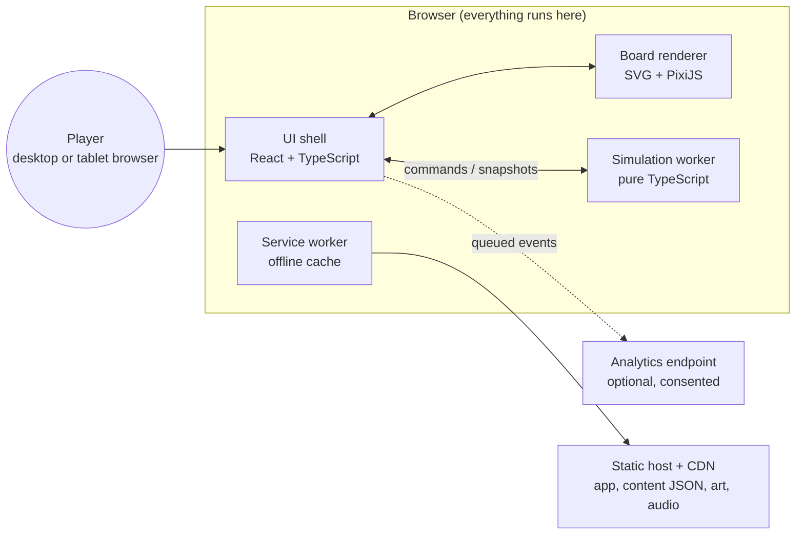

# Severity 1 — System Architecture PRD

November 18, 2026

Companion to the [Product Requirements Document](Severity-1-PRD.md) (the "product PRD") and the [Design System PRD](Severity-1-Design-System-PRD.md). Requirement IDs (FR-xx) refer to the product PRD.

## 1. Purpose and scope

This document defines how Severity 1 is built: the modules, the boundaries between them, the data formats, and the technical requirements each must meet. It is detailed enough for a small team to start the vertical slice (Tutorial, Chapters 1–2) without further architecture meetings, and it names what is decided and what is still open.

**In scope:** the browser client, the simulation engine, content formats, offline behaviour, analytics, testing, build and hosting.

**Out of scope for v1:** saving or persisting anything between visits, accounts, cloud sync and leaderboards (FR-21), multiplayer, user-generated levels, phone layouts, any server-side game logic.

## 2. Architecture principles

1. **The simulation is a pure function of its inputs.** Same level, design, seed and edit log give the same result, on any machine. No rendering, DOM, clock or `Math.random` inside the engine.
2. **The engine knows nothing about pixels; the renderer knows nothing about queueing theory.** They meet at one typed snapshot format.
3. **Content is data.** A new chapter, lesson or campaign ships as JSON validated in CI, with no engine or UI change.
4. **No required backend for gameplay.** The only network dependency is optional analytics, and the game is fully playable offline.
5. **Teach the right thing.** Where a simplification could teach a wrong intuition, the model is written so that every behaviour is directionally true (see section 6.4), and that is tested.
6. **Budget first.** Performance targets (section 11) are acceptance criteria, not goals.

## 3. System context



There is no application server. The static host serves the built app, content files, art and audio. The service worker caches all of it so the game runs offline after the first load.

## 4. Module overview

| Module | Responsibility | Depends on | Must not depend on |
| --- | --- | --- | --- |
| `engine` | Tick simulation, incidents, chaos, SLO evaluation, seeded RNG | `schema` | DOM, React, Pixi, storage |
| `schema` | TypeScript types and JSON Schemas for designs, levels, lessons, snapshots | none | everything else |
| `content` | Level, lesson, Codex and debrief JSON files; validation scripts | `schema` | engine internals |
| `board` | SVG machines, connections, ports, grid, camera, Pixi particle layer, x-ray view | `schema`, `tokens` | `engine` code (reads snapshots only) |
| `ui` | Menus, panels, Academy flow, Codex, debrief, metrics overlay, hint system | `schema`, `tokens`, `board` | `engine` code |
| `session` | Orchestrates a run: owns the worker, the edit log, undo/redo, run state, scoring | `engine` (via worker), `schema` | rendering |
| `telemetry` | Event queue, consent, batching, send | `schema` | gameplay logic |
| `audio` | Web Audio hum, effects, mixing, mute | `tokens` | `engine` |
| `tokens` | Design tokens as one JSON source, generated CSS and TS (see Design System PRD) | none | everything else |

A monorepo with these as packages (or top-level folders) is enough. Boundaries are enforced by lint rules on imports, not by publishing packages.

## 5. Technology choices

| Area | Choice | Why | Revisit if |
| --- | --- | --- | --- |
| Language | TypeScript, strict mode | Types are the contract between engine, content and renderer | never |
| UI | React | Matches the product PRD; mature accessibility story for panels and menus | bundle size misses the load budget |
| State (UI) | A small store such as Zustand | Light, works outside React for `session` | state graph becomes complex |
| Board | SVG for machines and wires; PixiJS (WebGL, canvas fallback) for particles | SVG gives crisp, styleable, accessible machines; Pixi handles thousands of sprites | SVG node count hurts frame time at large designs |
| Simulation host | Dedicated Web Worker | Keeps the main thread free for 60 fps rendering | none |
| Build | Vite | Fast dev loop, simple code-splitting | none |
| Storage | None. All state lives in memory for the visit | v1 is an experience, not a saved game; no database, no browser storage | players ask for saves (then add local storage, see FR-21) |
| Offline | Service worker with a precache manifest (Workbox or hand-rolled) | Satisfies the offline requirement | none |
| Validation | JSON Schema generated from the TypeScript types, run in CI | Bad content fails the build, not the player | none |
| Tests | Vitest (unit, engine), Playwright (end to end, visual), a perf script | See section 12 | none |
| Hosting | Any static host with a CDN and HTTP/2 or later | No backend needed | analytics volume needs a real service |

## 6. Simulation engine

### 6.1 Execution model

- **Fixed timestep.** The engine advances in ticks of a fixed simulated duration (proposed: 100 ms of simulated time per tick). Wall-clock speed is the player's speed setting (pause, 0.5x, 1x, 2x, 4x), which changes how many ticks run per second, never the tick content.
- **Rendering interpolates.** The worker posts one snapshot per tick. The renderer runs at display rate and interpolates between the two most recent snapshots.
- **No ambient inputs.** The engine receives everything through `init(level, design, seed)` and `apply(command)`. It never reads time, randomness or storage.
- **Seeded RNG.** One small, fast, well-known PRNG (for example sfc32 or mulberry32) seeded per run. Every random draw uses it, in a fixed order, so results are reproducible.
- **Numerics.** All sim math uses plain doubles with a fixed operation order. Anything iterated (components, connections) is iterated in a stable, sorted order by ID. Tests assert identical results across Chrome, Firefox and Safari.

### 6.2 Flow model: cohorts, not individual requests

Simulating each request as an object cannot scale to the traffic levels the lessons talk about. The engine moves **cohorts**: per tick, per request type, per edge, a count of requests with an associated latency accumulation.

- A cohort carries `{ type, count, accumulatedLatencyMs, regionOfOrigin, errorCount }`.
- Components accept cohorts, consume capacity, add queueing delay, and forward, drop (error) or transform them (a cache splits a read cohort into hits and misses).
- Each snapshot also carries a **sample** of individual request traces (up to a few hundred per tick) chosen with the seeded RNG. The renderer turns the sample into particles, and the x-ray view labels sampled traces. This matches the product PRD's rule that one particle stands for many requests.

### 6.3 Component model

Every component type implements the same small interface:

```ts
interface ComponentModel<S, C> {
  init(config: C): S;                               // initial state
  step(state: S, inbound: Cohort[], ctx: TickCtx): StepResult<S>; // consume, forward, emit metrics
  health(state: S): Health;                         // healthy | strained | overloaded | failing | down
}
```

- **Capacity and queueing.** Each instance has a capacity (requests per tick). Utilization is load divided by total capacity. Added latency follows a queueing curve that is flat at low utilization and rises sharply near 100%, capped, then requests wait in a bounded queue and finally time out as errors. One shared function implements this so every component behaves consistently.
- **Component specifics** (all parameters live in data, not code): cache hit rate from size, expiry and key popularity; cold-cache warm-up and stampede on failure; read replicas sharing reads while writes go to the primary, with replication lag; shard routing by key with hot-key skew; queue depth, retention and dead-letter behaviour; worker throughput; CDN hit rate by region; rate-limiter token buckets; DNS and geography latency by region distance.
- **Health** drives the visible state of the machine (see Design System PRD, load states) and incident detection.

### 6.4 Directional truth

To protect against "simplified numbers teach wrong lessons", the engine ships with **property tests** that encode real-world monotonic behaviour, for example:

- Adding instances never increases latency or error rate for a stateless tier.
- A higher cache hit rate never increases database load.
- Latency is non-decreasing in utilization.
- Writes always reach the primary; read replicas never serve writes.
- Moving users farther from the serving region never lowers latency.

Each lesson's toy simulation uses the same engine with a tiny design, so the lesson and the level cannot disagree.

### 6.5 Commands, edit log and replay

- The player's actions during a run are **commands** (`place`, `remove`, `connect`, `disconnect`, `setInstances`, `setConfig`, `setSpeed`, `pause`, `resume`). Each is applied at a tick boundary and recorded as `{ tick, command }`.
- A **run record** is `{ levelId, levelVersion, seed, startDesign, editLog }`. Replaying it through the engine reproduces the run exactly (FR-27, and the fairness requirement).
- **Run definition** matches the product PRD: Start from tick 0 begins a run; pause, edit and resume stay within it; restart begins a new run. The session module counts runs for the Senior engineer star.

### 6.6 Incidents, chaos, SLOs

- **Incident detector.** Rules in level data (metric, threshold, duration, severity, name template) are evaluated each tick. An incident opens when a rule holds for its duration and resolves when metrics recover. Opening and resolving are events in the snapshot stream.
- **Chaos events** are a seeded schedule from level data (crash, region outage, spike, bad deploy, cache flush, bot attack), applied as engine-level state changes at specific ticks.
- **SLO evaluator.** SLOs are judged over the final full traffic cycle of the run, as defined in the product PRD. Earlier incidents are recorded for the debrief but do not fail the SLOs. The evaluator outputs per-SLO pass/fail with the measured values, and the Ship it, Thrifty and Senior engineer decisions.
- **Minimum design check.** Levels may declare required components or settings (for example, a cache in the caching chapter). The evaluator fails the run with a specific reason if they are missing.

### 6.7 Engine API (worker boundary)

| Direction | Message | Payload |
| --- | --- | --- |
| UI to worker | `init` | level, start design, seed |
| UI to worker | `command` | one command from 6.5 |
| UI to worker | `setSpeed`, `pause`, `resume`, `reset` | speed or none |
| Worker to UI | `snapshot` | tick, per-component state and health, per-edge flow, metrics, sampled traces, open incidents, cost |
| Worker to UI | `event` | incident opened or resolved, chaos fired, SLO status changed |
| Worker to UI | `runComplete` | final metrics, SLO results, stars, run record |
| Worker to UI | `error` | message and context (also sent to telemetry) |

Snapshots are plain structured-clonable objects; large arrays use transferable typed arrays where profiling shows a need.

## 7. Content and data formats

All formats are versioned (`schemaVersion`) and validated by JSON Schema in CI.

| File type | Contains | Notes |
| --- | --- | --- |
| `level.json` | id, chapter, title, narrative text, unlocked components, start design id, reference design, traffic profile(s) with read/write/photo/upload mix, region mix, SLOs, budget, scripted incidents, chaos schedule, minimum design, hint tiers, debrief reference | The engine consumes the traffic, SLOs, incidents and chaos; the UI consumes the rest |
| `lesson.json` | id, concept, ordered beats (story hook, analogy morph, toy simulation, predict-then-see), toy simulation design and controls, prediction prompts and expected outcomes, Codex card id, unlocks | Toy simulations reuse the engine and a tiny design |
| `codex.json` | cards: analogy, short diagram reference, "how large social networks do it" note, sources | Sources are required (supports the accuracy review) |
| `design.json` | components (id, type, grid position, config, instances), connections (from port, to port, type) | Used for reference designs and starting designs |
| `debrief.json` | reference design, explanation of differences keyed by component, real-world note | Linked from the level |
| session state (not a file) | settings, progress (lessons done, stars, titles, achievements), current design and run record, consent state, anonymous ID | Held in memory only; gone when the tab closes |

**Content rules enforced in CI:** every placeable component appears in exactly one lesson's `unlocks`; every level's unlocked components exist; every reference design passes its own level's SLOs in the engine (so a debrief never shows a design that fails); every Codex card has at least one source.

## 8. Rendering architecture

- **Layers (bottom to top):** background and grid, connections (SVG), machines (SVG), particles (Pixi canvas), overlays and labels (SVG/HTML), UI panels (HTML).
- **Camera:** a single transform shared by the SVG and Pixi layers so zoom, pan and camera focus on incidents stay in sync.
- **Machines:** each component type is an SVG symbol with named layers (body, lights, status overlay, instance stack). Load state and utilization drive CSS custom properties and class changes (blink rate, glow, smoke), so state changes need no new draw calls.
- **Particles:** one Pixi `ParticleContainer`-style batch with pooled sprites per shape. Particle position is derived from the snapshot's edge flow and sampled traces. The cap is 2,000 live particles; when the sample exceeds the cap, the lowest-priority particles are dropped, never the failed ones.
- **Reduced-motion variant:** a separate render mode (not a CSS toggle) replaces particles with line thickness and dash speed on edges and replaces animations with static badges. It reads the same snapshot.
- **X-ray view:** slows simulated time, pins a sampled trace and draws labelled hops.
- **Input:** pointer and touch via pointer events with 44 px minimum targets on tablet; full keyboard building through a roving-focus model (see section 13).

## 9. Session state and offline

- **No persistence.** Nothing is written to a database, IndexedDB, localStorage or cookies. Every visit starts fresh at the first lesson; progress, designs, settings and replays live in memory and end with the tab.
- **Leaving the page.** The UI shows a one-line note on first load that progress is not saved, and the browser's native leave-page prompt is not used.
- **Offline.** The service worker precaches the shell and the first chapters, and caches later chapters and audio on first use. An update prompt appears when a new version is ready; it never reloads mid-run.

## 10. Analytics and privacy

- **Events** (FR-23): `lesson_started`, `lesson_completed`, `level_started`, `run_started`, `run_completed`, `incident_opened`, `hint_used` (with tier), `stars_awarded`, `check_taken` (before/after, FR-24), `drop_off` (inferred from last event), `error`.
- **No personal data.** An anonymous random ID generated per visit and kept in memory, no IP storage on our side where the host allows it, no third-party scripts, no fingerprinting. Events contain level and concept IDs and numbers only.
- **Consent first.** A first-run notice with an opt-out that works at any time. With consent off, no events are sent or queued. Consent is not remembered, so the notice appears on every visit.
- **Delivery.** Events queue in memory and send in batches when online using `sendBeacon` or `fetch`. A failing endpoint never affects gameplay.
- **Endpoint.** A minimal collection service (or a managed analytics product configured with a custom event schema). This is the one piece of backend in v1 and is optional to deploy; the open question is build vs. buy.

## 11. Non-functional requirements and budgets

| Area | Requirement | How it is met and checked |
| --- | --- | --- |
| Frame rate | 60 fps with 2,000 particles on a mid-range laptop | Pooled sprites, one batch, worker-hosted sim; a perf script records frame times in CI on a reference profile |
| Load time | Playable within 3 seconds on typical broadband | Initial JS budget (proposed: 250 KB gzipped for shell and board), code-split lessons and chapters, lazy-loaded audio and art, Lighthouse check in CI |
| Tick cost | Engine tick under 4 ms for the largest level design, so 2x–4x speeds hold | Benchmarks per level in CI; regression threshold fails the build |
| Memory | Stable over a 30-minute session | Soak test; pooled particles, bounded run logs |
| Determinism | Identical results across supported browsers | Golden replays run in all three engines (section 12) |
| Offline | Fully playable offline after first load | Playwright offline test through a full level |
| Accessibility | WCAG 2.1 AA for menus and text, keyboard-operable building, reduced-motion mode | Section 13 and the Design System PRD; automated axe checks plus manual checks per release |
| Browsers | Latest Chrome, Safari, Firefox, Edge on desktop; tablets | Playwright matrix on all four engines; touch tests on a tablet profile |
| Security | No user-generated content or accounts in v1 | Strict Content Security Policy, no third-party scripts, dependency audit in CI |

## 12. Testing strategy

1. **Engine unit tests:** each component model, the queueing function, RNG determinism.
2. **Property tests:** the monotonic and conservation rules in 6.4, using generated designs.
3. **Golden replays:** for every level, a stored run record plus expected metrics hash, run in Chrome, Firefox and WebKit. A change in output is either a bug or an intentional rebalance that updates the golden file in review.
4. **Content validation:** the CI rules in section 7, including "every reference design passes its level".
5. **Solvability and anti-brute-force checks:** automated scripts that try (a) the reference design (must pass), (b) the starting design (must fail), and (c) a design that only adds instances (must fail where the level says scaling alone cannot pass).
6. **Component and visual tests:** Storybook stories for every design system component and machine state, with screenshot comparison.
7. **End-to-end:** Playwright flows for the tutorial, a full level, offline play, and keyboard-only building.
8. **Playtest instrumentation:** the analytics events double as the data for the slice gates (fun rating, concept check, drop-off).

## 13. Accessibility architecture

- **Keyboard building model.** The board has a focus ring over components and ports. Arrow keys move focus across the grid; Enter selects; a command palette ("add cache", "connect A to B") offers an alternative to dragging. Every drag action has a keyboard equivalent.
- **Screen reader surface.** An off-screen, structured description of the design (components, connections, state) and an ARIA live region for incidents and run results. The animation is decoration; the facts are text.
- **Reduced motion** and **adjustable speed** are first-class settings held in session state (FR-18).
- **Status** is always icon plus shape plus color, enforced in the design tokens.
- **Audio** never carries information alone; every sound cue has a visual equivalent.

## 14. Build, delivery and environments

- **Repo:** one repository. CI runs lint (including import-boundary rules), type check, unit and property tests, content validation, build, bundle-size check, Playwright, and the perf script.
- **Environments:** local, preview per pull request (static deploy), production. A preview build is what playtesters use.
- **Releases:** content-only releases are possible because content is data. The service worker versions the precache so players get a consistent set of files.
- **Error reporting:** unhandled errors and worker errors go through the telemetry queue (with consent) with level, tick and a hash of the design, never the design contents.

## 15. Requirement traceability

| FR | Primary module(s) | Section |
| --- | --- | --- |
| FR-01 grid canvas, ports, zoom/pan | `board`, `session` | 8 |
| FR-02 scaling and live cost | `engine`, `ui` | 6.3, 8 |
| FR-03 real-time tick sim | `engine` | 6 |
| FR-04 request particles and load states | `board` | 8 |
| FR-05, FR-06 Academy flow and locking | `ui`, `content` | 7 |
| FR-07 incidents, camera, hints | `engine`, `ui` | 6.6 |
| FR-08 SLOs and stars | `engine`, `session` | 6.5, 6.6 |
| FR-11 guided build | `ui`, `board` | 8 |
| FR-12 Codex, FR-26 glossary | `ui`, `content` | 7 |
| FR-13 metrics overlay | `ui` | 6.7 |
| FR-14 chaos events | `engine` | 6.6 |
| FR-15 debrief, FR-27 replay | `ui`, `session` | 6.5, 7 |
| FR-17 settings panels | `ui` | 7 |
| FR-18 accessibility | all UI modules | 13 |
| FR-23 analytics | `telemetry` | 10 |
| FR-24 before/after check | `ui`, `telemetry` | 10 |
| FR-25 starting designs | `content`, `session` | 7 |
| FR-28 original art only | `content`, art pipeline | Design System PRD |

## 16. Phasing

| Phase | Architecture deliverables |
| --- | --- |
| 1. Vertical slice | `schema`, `engine` (client, server, database, object storage, load balancer, queueing core, incidents, SLOs), `board` with greybox art, Academy flow, analytics, golden replays, CI |
| 2. Campaign alpha | Remaining component models, chaos, Codex, debrief and replay, settings panels, content pipeline for chapters 3–9 |
| 3. Beta and polish | Boss level, performance tuning, accessibility audit, final art and audio integration |
| 4. Launch | Offline hardening, analytics review, load testing the static host, release runbook |

## 17. Risks

| Risk | Impact | Mitigation |
| --- | --- | --- |
| Cohort model feels abstract or hides emergent behaviour (for example, uneven load across instances) | Simulation less convincing than individual requests | Model per-instance load inside a cohort step; validate with the slice playtest; keep the sampled traces honest |
| Cross-browser floating-point differences break determinism | Replays and fairness fail | Golden replays in three engines in CI; avoid transcendental functions that differ by engine, or use a fixed implementation |
| SVG node count grows with large designs | Frame drops on big boards | Instance stacks rendered as a pattern, off-screen culling, profile in the slice; fall back to canvas for machines only if needed |
| Content and engine drift apart | Reference designs fail, lessons contradict levels | CI rules in section 7; lessons reuse the engine |
| Tuning the model by hand is slow | Chapters feel unfair | Solvability scripts and a debug overlay showing utilization and queue per component |

## 18. Decisions and open questions

**Decided**

- Browser-only, static hosting, no required backend.
- Engine in a Web Worker, pure TypeScript, cohort-based flow with sampled traces.
- Content as validated JSON; one engine for levels and lesson toy simulations.
- No database and no saving: all state is in memory for the visit.
- Consent-gated, anonymous analytics.

**Open**

- Tick length and the exact queueing curve (decide from the first slice tuning).
- Build or buy the analytics endpoint.
- Whether to use Workbox or a hand-written service worker.
- Whether the largest late-game designs need a canvas fallback for machines.
- Hosting provider and domain, which depend on the budget question in the product PRD.
